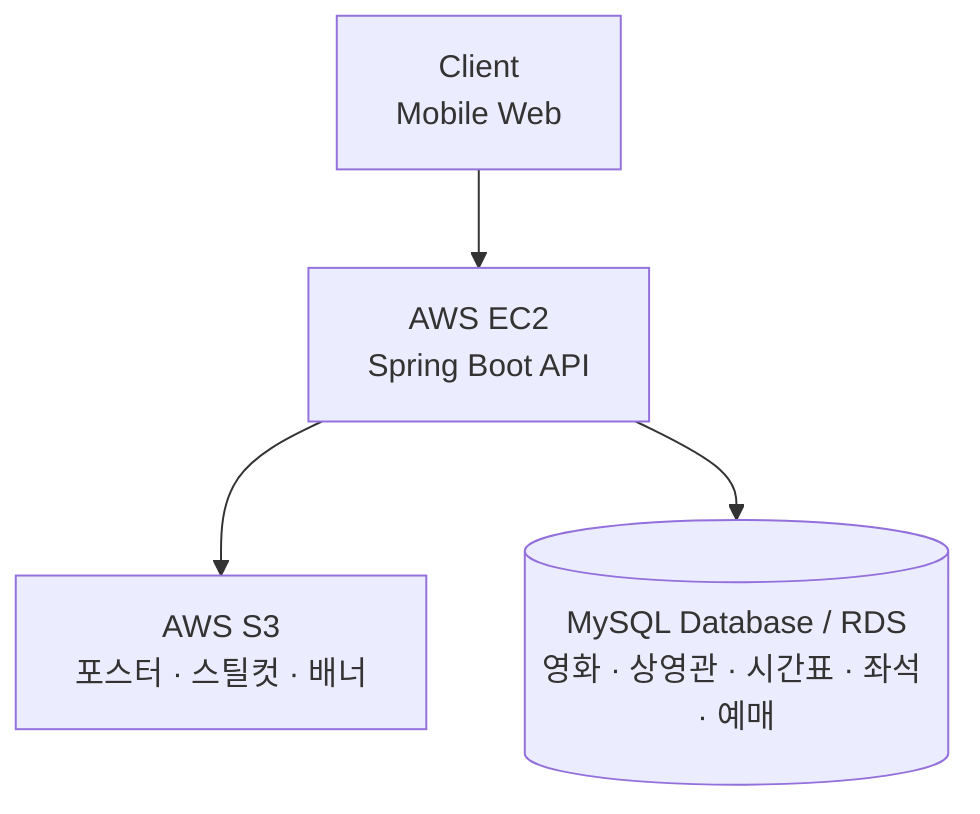

# 39-COLLABORATION-SERVER-LOTTECINEMA


롯데시네마 모바일 웹 서비스의 사용자 경험 개선을 위한 백엔드 API 서버입니다.


## 🛠 기술 스택

| 구분 | 기술 |
| --- | --- |
| Backend | Java, Spring Boot, Spring Data JPA, Lombok |
| Build & API Docs | Gradle, Swagger |
| Database & Storage | MySQL, AWS S3 |
| Infrastructure | Docker, Docker Compose, AWS EC2, AWS RDS |

## 🏛 서버 아키텍처

### 로컬 개발 환경

`docker-compose.yml`을 사용해 로컬 MySQL 및 개발 인프라를 컨테이너로 실행합니다. 팀원마다 독립된 개발 환경을 구성하며, 호스트 포트 충돌을 피하기 위해 MySQL 포트를 `3307`로 매핑합니다.

### 운영 환경 구성안

| 구성 | 아키텍처 | 특징 |
| --- | --- | --- |
| Option A | AWS EC2 + AWS RDS(MySQL) + AWS S3 | 관리형 데이터베이스를 활용하는 고가용성 구성 |
| Option B | AWS EC2(Spring Boot + MySQL on Docker) + AWS S3 | 컨테이너 기반 운영으로 비용을 최적화하는 구성 |

> 운영 환경은 서비스 요구사항과 비용을 고려해 두 구성안 중 선택합니다.

### 정적 미디어 저장소

영화 포스터, 스틸컷, 배너 등 대용량 미디어는 AWS S3에 저장합니다. API 서버와 미디어 저장소를 분리해 서버의 네트워크 및 디스크 I/O 부하를 줄입니다.



## 🌿 브랜치 전략

Git-Flow 기반으로 상시 유지 브랜치와 기능별 보조 브랜치를 운영합니다.

| 분류 | 브랜치 | 설명 | 머지 대상 |
| --- | --- | --- | --- |
| 상시 유지 | `main` | 실제 배포 가능한 프로덕션 브랜치 | - |
| 상시 유지 | `dev` | 다음 출시 버전을 개발하고 통합하는 브랜치 | `main` |
| 보조 | `feat/#이슈번호` | 개별 기능 개발 브랜치 | `dev` |
| 보조 | `hotfix/#이슈번호` | 운영 환경의 긴급 버그 수정 브랜치 | `main`, `dev` |

### 팀 브랜치 규칙

1. 기능 브랜치는 최신 `dev`에서 분기합니다.

   ```bash
   git checkout dev
   git pull origin dev
   git checkout -b feat/#이슈번호
   ```

2. 커밋 메시지에는 이슈 번호 또는 명확한 접두사를 포함합니다.

   ```text
   feat: #이슈번호 기능 설명
   ```

3. 기능 브랜치의 PR은 `dev`를 대상으로 생성합니다 (`feat` → `dev`).
4. `main`에 직접 push하지 않습니다. `main`에는 `dev` 또는 `hotfix`를 통해서만 머지합니다.
5. 모든 PR은 팀원 리뷰와 승인 후 병합합니다.

## 📂 프로젝트 구조

도메인별로 연관된 구성 요소를 모아 비즈니스 로직의 응집도와 유지보수성을 높입니다.

```text
src
└── main
    ├── java/org/sopt/lottecinema
    │   ├── global
    │   │   ├── common       # 공통 응답 (예: ApiResponse)
    │   │   ├── config       # 공통 설정 (예: WebConfig, SwaggerConfig)
    │   │   └── exception    # 예외 처리 (예: GlobalExceptionHandler, ErrorCode)
    │   └── [domain]         # 도메인별 Entity, Controller, Service, DTO
    └── resources
        └── application.yml  # 환경 변수 기반 설정

docker-compose.yml           # 로컬 개발 인프라
README.md
```

## 🚀 시작하기

아래 절차를 따라 Docker 기반의 로컬 데이터베이스와 Spring Boot 애플리케이션을 실행합니다.

### 1. 저장소 복제

```bash
git clone https://github.com/SOPT-all/39-COLLABORATION-SERVER-LOTTECINEMA.git
cd 39-COLLABORATION-SERVER-LOTTECINEMA
```

### 2. 환경 변수 파일 준비

`.env`에는 실제 계정 정보가 포함될 수 있으므로 Git에 커밋하지 않습니다. 해당 파일은 `.gitignore`에 등록되어 있어야 합니다.

### 3. MySQL 컨테이너 실행

```bash
docker compose up -d
docker compose ps
```

`docker compose ps` 결과에서 컨테이너 상태가 `Up` 또는 `running`인지 확인합니다.

### 4. Spring Boot 애플리케이션 실행

IntelliJ에서 `LottecinemaApplication.java`를 실행하거나 터미널에서 다음 명령을 실행합니다.

```bash
./gradlew clean build
./gradlew bootRun
```

### 5. Swagger API 문서 확인

서버 실행 후 브라우저에서 Swagger UI를 엽니다.

<http://localhost:8080/swagger.html>
